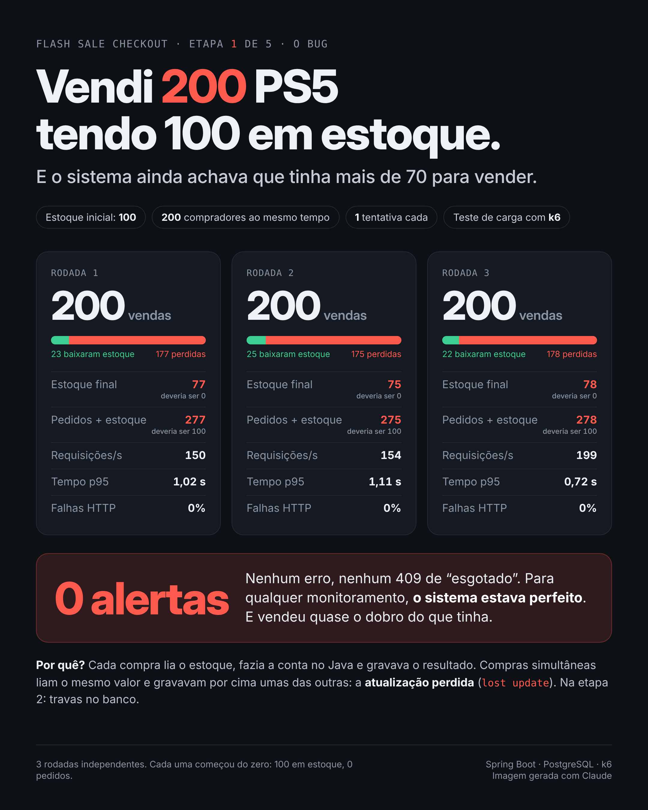

# 🛒 Flash Sale Checkout

> Simulação de um checkout de Black Friday: **100 unidades em estoque, milhares de compradores ao mesmo tempo**. O objetivo é simples de explicar e difícil de fazer: **não vender mais do que existe**.


---

## 📌 O problema

Toda compra passa por três passos: **ler o estoque**, **verificar se ainda tem** e **diminuir uma unidade**.

Com um cliente por vez, isso funciona. Mas quando muitas requisições chegam no mesmo instante, várias delas leem o mesmo estoque ao mesmo tempo, todas acreditam que podem vender e cada uma grava o seu resultado por cima da outra.

Esse comportamento se chama **condição de corrida** (*race condition*). No caso do estoque, ele aparece como **atualização perdida** (*lost update*) e causa o famoso **overselling**: vender mais do que se tem.

Este projeto reproduz o problema de propósito e depois resolve, etapa por etapa, medindo o resultado de cada solução com testes de carga.

---

## 🧰 Stack

| Tecnologia | Papel no projeto |
|---|---|
| **Java 25 LTS + Spring Boot** | API de vendas |
| **PostgreSQL + Flyway** | Banco de dados de produtos e pedidos, com migrations versionadas |
| **Redis** | Reserva de estoque em memória |
| **RabbitMQ** | Fila para processar pedidos sem sobrecarregar o banco |
| **Docker / Docker Compose** | Ambiente completo com um comando |
| **k6** | Testes de carga e coleta de métricas |

---

## 🗺️ Etapas

| # | Etapa | O que acontece | Status |
|---|---|---|---|
| 1 | **O bug** | Implementação ingênua: o sistema vende mais do que tem em estoque | ✅ [Concluída](../../tree/etapa-1) |
| 2 | **Lock no banco** | Correção com travas no banco (otimista, pessimista e update atômico) e por que elas sofrem sob carga | 🔄 Em andamento |
| 3 | **Reserva no Redis** | Estoque controlado em memória com operações atômicas | ⏳ Pendente |
| 4 | **Fila no RabbitMQ** | Pedidos processados de forma assíncrona, no ritmo que o banco aguenta | ⏳ Pendente |
| 5 | **Resultados** | Comparação final dos números: antes × depois | ⏳ Pendente |

> Cada etapa tem uma **tag no Git** para que seja possível ver o código exatamente como estava naquela fase.

---

## 📊 Resultados

**Cenário de teste:** 100 unidades em estoque, **200 compradores ao mesmo tempo**, cada um tentando comprar 1 vez. Mesma carga e mesma máquina em todas as etapas. Cada rodada começa do zero (100 em estoque, 0 pedidos).

| Etapa | Requisições/s | Tempo p95 | Taxa de erro | Vendas além do estoque |
|---|---|---|---|---|
| 1. Ingênua | 150 a 199 | 0,72 a 1,11 s | 0% | **100** (em 3 de 3 rodadas) |
| 2. Lock no banco | — | — | — | — |
| 3. Redis | — | — | — | — |
| 4. Redis + RabbitMQ | — | — | — | — |

### Etapa 1 em detalhe

A regra que nunca pode quebrar: **pedidos + estoque = 100**.

| Rodada | Vendas | Estoque final | Pedidos + estoque | Baixas de estoque perdidas | Req/s | p95 | Erros HTTP |
|---|---|---|---|---|---|---|---|
| 1 | 200 | 77 | **277** | 177 | 150 | 1,02 s | 0% |
| 2 | 200 | 75 | **275** | 175 | 154 | 1,11 s | 0% |
| 3 | 200 | 78 | **278** | 178 | 199 | 0,72 s | 0% |

Nas três rodadas, o sistema vendeu **200 unidades tendo 100**, sem nenhum erro, e terminou acreditando que ainda tinha mais de 70 para vender.



---

## ▶️ Como rodar

**Pré-requisitos:** Docker Desktop e Java 25.

1. Suba o banco:
   ```bash
   docker compose up -d
   ```
2. Suba a aplicação:
   ```bash
   ./mvnw spring-boot:run
   ```
   O Flyway cria as tabelas e cadastra o PS5 com 100 unidades.
3. Antes de cada teste, rode `k6/reset.sql` no banco para voltar ao estado inicial.
4. Aqueça a aplicação:
   ```bash
   docker compose run --rm k6 run /scripts/smoke.js
   ```
5. Rode o teste de compra:
   ```bash
   docker compose run --rm k6 run /scripts/compra.js
   ```
6. Confira o resultado com `k6/invariante.sql`.

O arquivo `flash-sale-checkout.http` tem exemplos de requisições para testar a API manualmente.

---

## 💡 O que aprendi

- **Etapa 1:** `@Transactional` garante "tudo ou nada", mas não impede duas compras de lerem o mesmo estoque ao mesmo tempo. Como o Hibernate grava o valor calculado no Java (`estoque = 77`), e não uma operação (`estoque - 1`), compras simultâneas apagam o trabalho umas das outras. A regra `CHECK (estoque >= 0)` nunca disparou: o estoque não ficou negativo, ficou **errado**. E o mais perigoso: 0% de erro HTTP. Nenhum monitoramento teria percebido.
- **Etapa 2:** —
- **Etapa 3:** —
- **Etapa 4:** —
- **Etapa 5:** —

---

## 📝 Série de posts

Cada etapa deste projeto vira um post contando o problema, a solução e os números.

1. *Vendi 200 PS5 tendo 100 em estoque* — [link do post]
2. *Travas no banco: resolvem, mas a que custo?* — em breve
3. *Reserva de estoque no Redis* — em breve
4. *Fila no RabbitMQ para proteger o banco* — em breve
5. *De X para Y requisições por segundo* — em breve

---

## 👤 Autor

**Arthenyo**

[LinkedIn](https://github.com/ArthenyoCarlos) · [GitHub](https://www.linkedin.com/in/arthenyo-carlos-9505ba307/)

---

## 📄 Licença

Distribuído sob a licença MIT. Veja o arquivo `LICENSE` para mais detalhes.